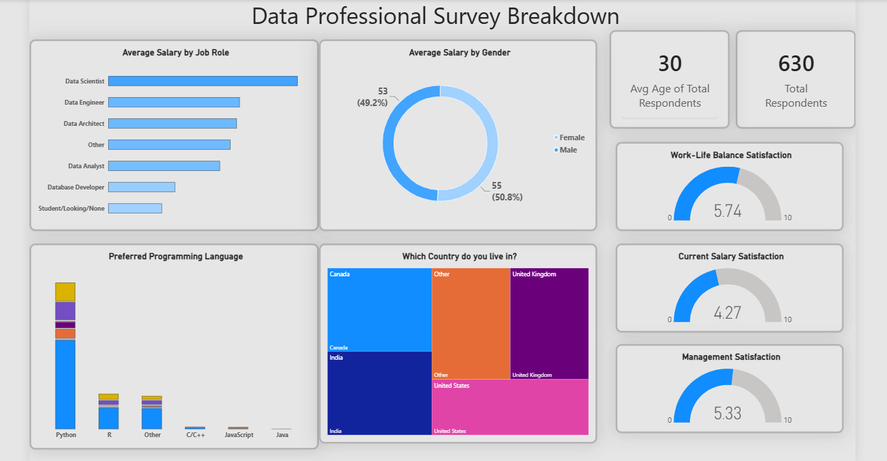

# Data Professional Survey Analysis 
# Data Professional Survey Dashboard | Power BI
## Project Overview
An interactive Power BI dashboard developed to analyse survey responses from 630 data professionals. The project explores salary trends, programming language preferences, respondent demographics and workplace satisfaction.
## Dashboard Preview

## Key Metrics
- **Total Respondents:** 630
- **Average Age:** 30 years
- **Work-Life Balance Satisfaction:** 5.74/10
- **Salary Satisfaction:** 4.27/10
- **Management Satisfaction:** 5.33/10
## Analysis & Key Insights
- **Salary Analysis:** Data Scientists have the highest average salary among the job roles represented.
- **Programming Languages:** Python is the most preferred programming language among respondents.
- **Gender Analysis:** Compared average salaries and respondent distribution by gender.
- **Country Distribution:** Explored survey participation across different countries.
- **Workplace Satisfaction:** Work-life balance (5.74/10) scores higher than salary satisfaction (4.27/10).
## Tools & Technologies
- Microsoft Power BI
- Data Cleaning & Transformation
- Data Visualisation
- Interactive Dashboard Design
## Project Files
- `Dashboard/` – Power BI dashboard (.pbix)
- `Dataset/` – Survey dataset
- `Images/` – Dashboard screenshot
## Outcome
Transformed raw survey responses into an interactive dashboard, making it easier to identify salary patterns, career preferences and workplace satisfaction trends among data professionals.
## Author
**Abhishek Shrivastava**
[LinkedIn Profile](https://www.linkedin.com/in/abhishek-shrivastava2707/)
